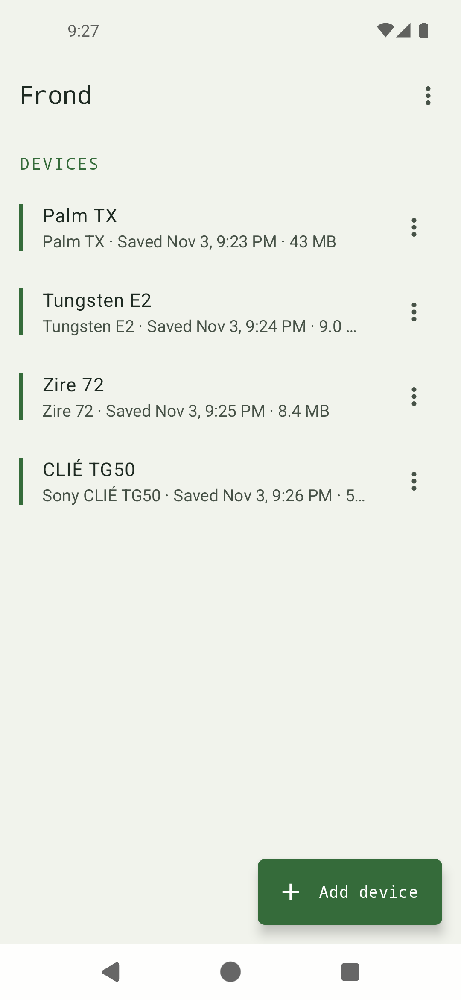
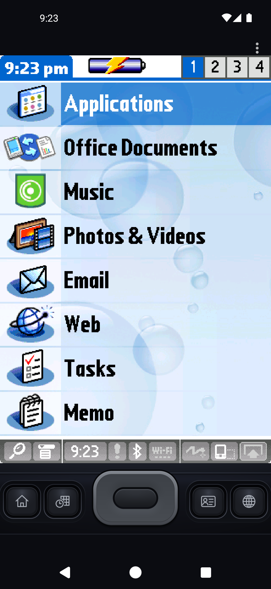
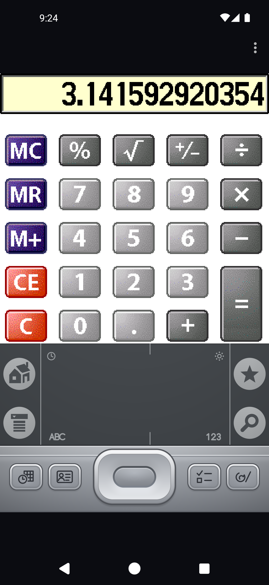
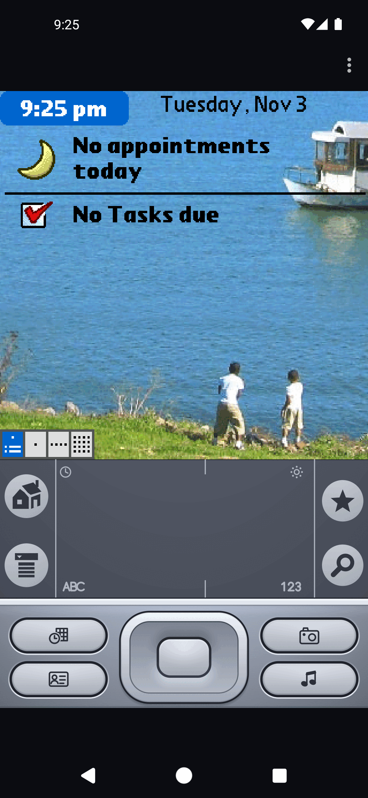
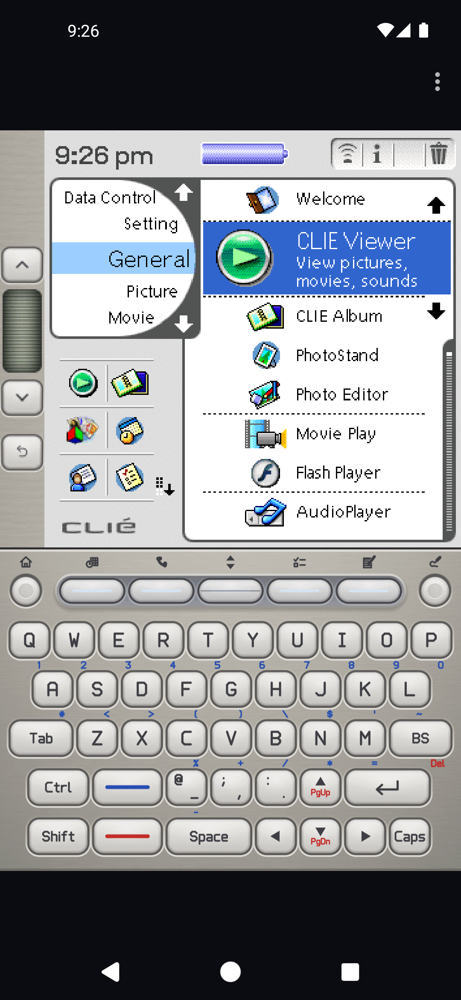
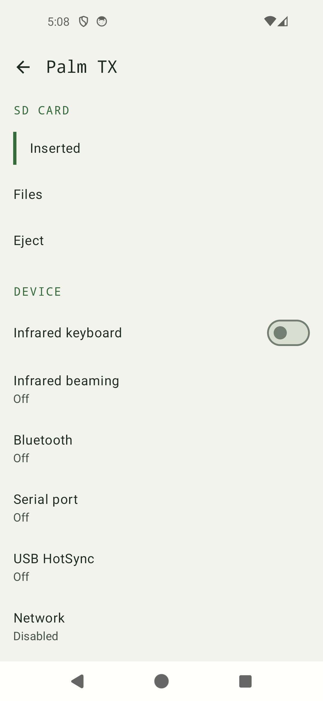

# Frond

Frond is a Palm OS emulator for Linux and Android, based on [CloudpilotEmu](https://github.com/cloudpilot-emu/cloudpilot-emu) and [uARM](https://github.com/uARM-Palm/uARM), for running and developing Palm apps and games.

It runs the Palm T|X, Tungsten E2 and Zire 72, plus the Sony CLIÉ TG50 as experimental, with sound, SD cards, networking, saved sessions and more. More devices are planned.

You need firmware for each device, none is included.

Let me know what works, what doesn't and what you'd like in #frond [on my discord](https://discord.gg/9Wun47jGC6), or open an issue here.

Enjoy!<br>
Dan

<table>
  <tr>
    <td align="center"><br>Devices</td>
    <td align="center"><br>Palm T|X</td>
    <td align="center"><br>Tungsten E2</td>
  </tr>
  <tr>
    <td align="center"><br>Zire 72</td>
    <td align="center"><br>CLIÉ TG50</td>
    <td align="center"><br>Peripherals</td>
  </tr>
</table>

## Getting it

- Linux (amd64, or arm64 for a Raspberry Pi): add my apt repo as shown on https://hunke.ws/apt/ and run `sudo apt install frond`. It shows up in the application menu.
- Android 8 and up: add my F-Droid repo https://hunke.ws/fdroid/repo in your F-Droid client and updates come with it.
- The APK and Debian packages are also on the [GitHub releases](https://github.com/roge-rm/frond/releases) page.

To build it yourself on Debian 13 (Trixie):

```sh
sudo apt install git build-essential python3 cmake qt6-base-dev qt6-wayland \
  libsdl2-dev libsdl2-image-dev libreadline-dev libcurl4-openssl-dev libslirp-dev pkg-config mtools
git clone --recurse-submodules https://github.com/roge-rm/frond.git
cd frond
make -j4
./out/frond-desktop
```

`make deb` builds a Debian package in `out/` instead, which also needs `dpkg-dev` and `binutils`. Neither the packages nor the APK include firmware or Palm apps.

## Firmware

| Device | NOR | NAND |
|---|---|---|
| Palm TX | 16 MiB | 132 MiB raw dump, with spare bytes |
| Tungsten E2 | 8 MiB | 34,603,008 bytes raw dump, optional |
| Zire 72 | 14,942,208 bytes | none |
| Sony CLIÉ TG50 | 13,041,664 bytes | none |

Frond works out the device from the NOR and never changes the files. On Linux use File → Firmware… or Add device, on Android import them when you add a device. Go through Palm OS setup the first time, and if taps land in the wrong place, calibrate the screen in Prefs.

## Using it

### Sessions

Each Palm you run is a saved session, listed on the home screen, where you can rename, export, import and delete them. There's no autosave, so a crash loses what changed since the last save. On Linux closing the window saves it, Save and Stop goes back to the list and Save a copy… keeps a separate snapshot. Sessions hold your firmware and personal data, so keep them private.

Hard reset in the session controls erases the Palm, and Save first saves it before. The TX and E2 ask first (press up to erase), the Zire erases straight away.

Each machine has its own display, smoothing and sound settings. Set them when you add it, or with Edit settings while it's stopped. On Android the menu while it runs has them too.

### Screen

On Linux pick a scale from 1× to 2× in 0.25 steps before starting, it defaults to the largest that fits. On Android the screen fits the phone, in whole steps or filling it, and follows the phone or stays in portrait or landscape. Pixels stay sharp unless you turn on Smooth LCD scaling.

### Buttons

The buttons under the screen and the E2's and Zire's silkscreens can be clicked or tapped. On a keyboard the arrow keys are the five-way, Enter selects and F1 to F4 are the app buttons, Help → Hardware Keyboard Controls lists them all. On Android game controllers press the Palm's buttons, and you can change which does what in Settings.

The TG50 has its keyboard, jog wheel, Home, Back and Hold. Hold locks the controls and turns off the screen, and audio keeps playing.

You can also type with an emulated Palm infrared keyboard, which needs Palm's keyboard driver.

### Apps and cards

Install PRC and PDB files with File → Install Application on Linux, or Install application on the Peripherals screen on Android.

Frond makes and imports SD card images, up to 2 GB (1 GB on the E2), and copies files between your computer or phone and an ejected card (SD Card → Exchange Files… on Linux). Close files on the Palm before ejecting.

The TG50 takes a Memory Stick from 4 to 128 MB, or a Memory Stick Pro from 256 MB to 2 GB. Files copies files and folders to and from it, up to 8 MiB each. Sony Launcher runs apps from its Card category. See [Memory Stick storage](doc/memory-stick.md).

### Peripherals

| | T\|X | E2 | Zire 72 | TG50 |
|---|---|---|---|---|
| Virtual Wi-Fi, onto the internet through your computer or phone | yes | | | |
| Cradle serial port, to a PTY or TCP port for terminal programs | yes | | | yes |
| Microphone | | | | yes |
| USB HotSync over a PTY or TCP port | yes | yes | yes | yes |
| [Infrared beaming](doc/infrared.md) between Frond instances | yes | yes | yes | yes |
| [Virtual Bluetooth](doc/bluetooth-provider.md), with a local provider you start yourself | yes | yes | yes | yes |

The rest stay greyed out until they're done, like the E2's and Zire's networking and serial and the Zire's camera.

The infrared keyboard and beaming share the port, so detach the keyboard before turning beaming on. On Android infrared, Bluetooth, serial, USB HotSync and the gdb server go over the network, to another Frond or to `tools/link-irda.py`, `tools/link-bluetooth.py` and `tools/link-pty.py` (for pilot-link) on a computer.

The TG50 plays beeps, alarms and Sony Voice Recorder audio. Its microphone is off at each start, and saving, stopping or going to the background turns it off again. Android asks for permission the first time. Bluetooth is tested with serial (SPP) and object exchange. Standard Palm SndStream, low-latency audio, remote control infrared, MagicGate and Memory Stick audio aren't there yet.

### Low-latency audio

On the T|X and E2, off by default. It plays one 44.1 kHz stereo stream with less delay, for music apps like SunVox, and goes back to the normal path when your computer or phone can't keep up. See the [audio limits](doc/fast-audio.md).

More in the [desktop guide](doc/desktop.md), the [peripheral guide](doc/peripherals.md), the [serial guide](doc/tx-serial.md) and the [E2 notes](doc/e2-qualification.md).

## For developers

- The [developer runner](doc/developer-run.md) installs and launches apps, exports RAM databases and fetches logs from the command line.
- The [debugger](doc/debugger.md) works with GDB: ARM and Thumb stepping, breakpoints, PACE inspection and 68k stepping, no watchpoints yet. On Android turn on the gdb server in Settings.
- [Compatibility tests](doc/compatibility.md) check apps for launch, interaction, saved data and restore.
- [Input and audio timing](doc/input-latency.md) tools measure latency.

Tests that need no firmware:

```sh
make test
QT_QPA_PLATFORM=offscreen make test-desktop
make test-build-tools check-reconstruction
```

The upstream core is pinned in `vendor/cloudpilot`, and the ordered patches in `patches/` are applied to it in `build/source`. The Android app is in `android/`. See [build validation](doc/build-validation.md) and [session testing](doc/session-testing.md).

## Credits and licence

Frond is built on [CloudpilotEmu](https://github.com/cloudpilot-emu/cloudpilot-emu) (its execution core, PACE support and SDL frontend) and Dmitry Grinberg's [uARM](https://github.com/uARM-Palm/uARM) TX board model. Thanks to their authors.

GPL-3.0-or-later, see [LICENSE](LICENSE). Palm firmware and apps have their own licences and must be supplied separately.
