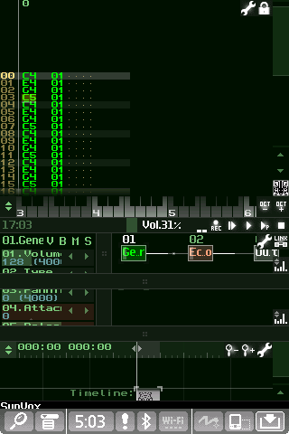
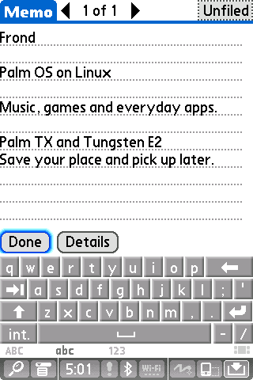
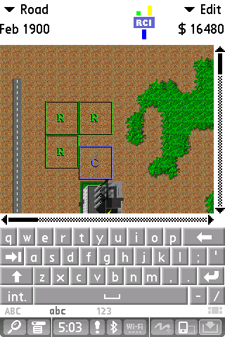
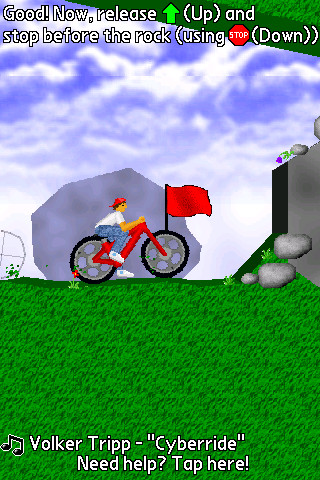
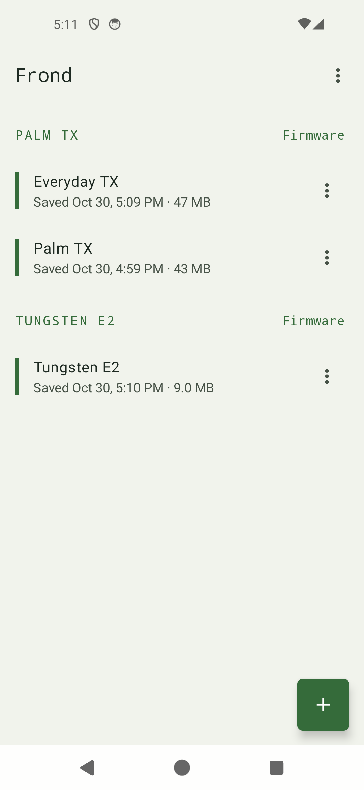
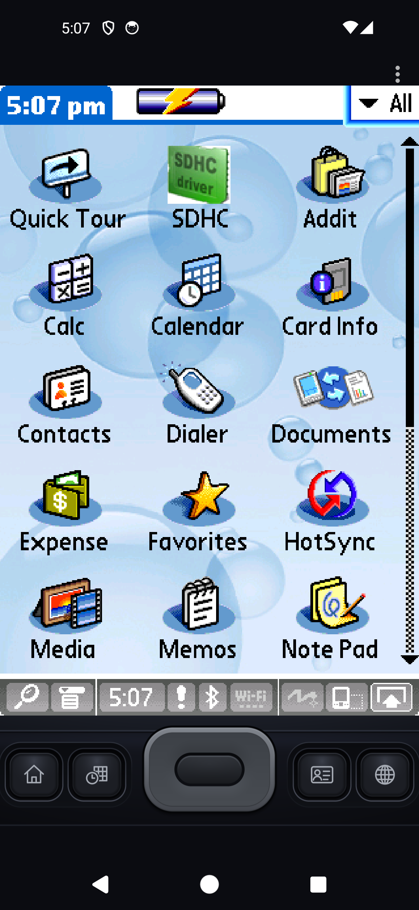
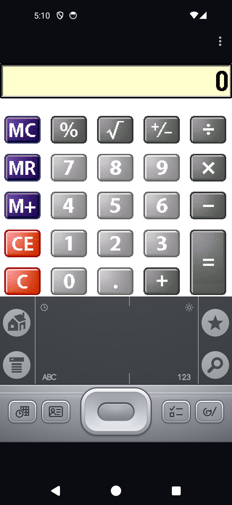
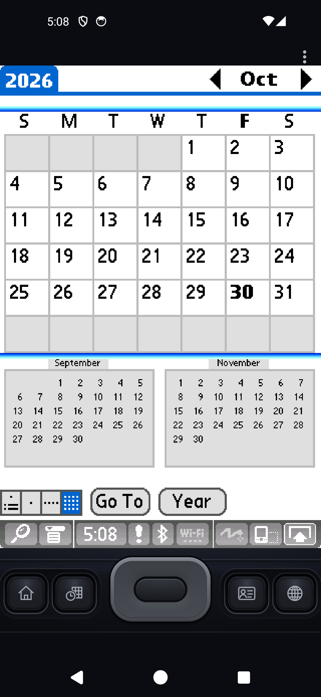
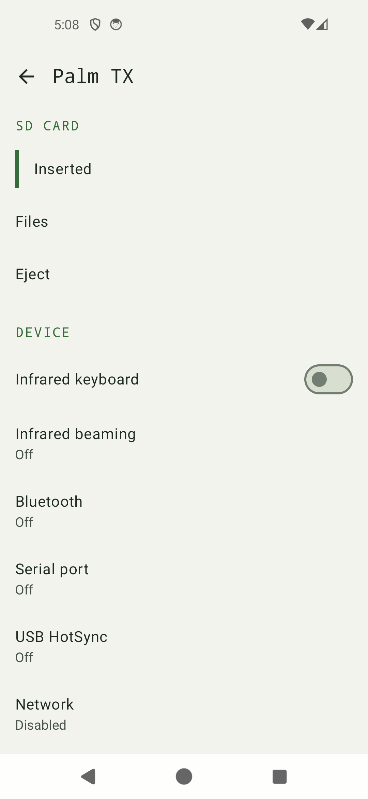
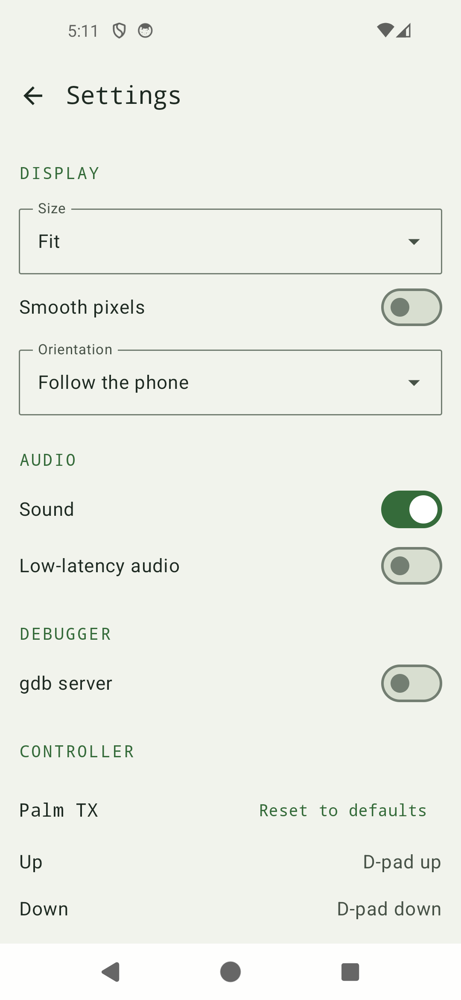

# Frond

Frond is a Palm OS emulator for Linux and Android, made for running and developing Palm apps and games.
Currently it emulates the Palm T|X and the Tungsten E2, with their buttons, sound, SD
card, sleep and wake, and saved sessions. More devices are planned.

To run this you will need to provide a Palm T|X or E2 device firmware as none are included.
This is an early release - 0.5.0 - but so far results are promising.

Dan

<table>
  <tr>
    <td align="center"><br>SunVox · input area hidden</td>
    <td align="center"><br>Memos · keyboard open</td>
  </tr>
  <tr>
    <td align="center"><br>SimCity · keyboard open</td>
    <td align="center"><br>Bike · full screen</td>
  </tr>
</table>

And on Android:

<table>
  <tr>
    <td align="center"><br>Sessions</td>
    <td align="center"><br>T|X launcher</td>
    <td align="center"><br>E2 Calculator</td>
  </tr>
  <tr>
    <td align="center"><br>T|X Calendar</td>
    <td align="center"><br>Peripherals</td>
    <td align="center"><br>Settings</td>
  </tr>
</table>

## Getting it

On Linux, add my apt repo as shown on https://hunke.ws/apt/ and run `sudo apt install frond`.
The package adds Frond to the application menu.

On Android 8 and up, phones and tablets, add my F-Droid repo https://hunke.ws/fdroid/repo
in your F-Droid client, and updates come with it. The APK is also on the
[GitHub releases](https://github.com/roge-rm/frond/releases) page, with the Debian package.

To build it yourself on Debian 13 (Trixie):

```sh
sudo apt install git build-essential python3 cmake qt6-base-dev qt6-wayland \
  libsdl2-dev libsdl2-image-dev libreadline-dev libcurl4-openssl-dev libslirp-dev pkg-config mtools
git clone --recurse-submodules https://github.com/roge-rm/frond.git
cd frond
make -j4
./out/frond-desktop
```

`make deb` builds a Debian package instead (also needs `dpkg-dev` and `binutils`), which
installs with `sudo apt install ./out/frond_0.5.0-1_amd64.deb`. Neither the packages nor
the APK include firmware or Palm apps.

## Firmware

| Device | NOR | NAND |
|---|---|---|
| Palm TX | 16 MiB | 132 MiB raw dump, with spare bytes |
| Tungsten E2 | 8 MiB | 34,603,008 bytes raw dump, optional |

Frond detects the device from the NOR and reads the files without changing them. On
Linux choose the files and click **Start**; on Android import them when you add a
device. Go through Palm OS setup the first time. If taps land in the wrong place,
calibrate the screen in Palm Preferences.

## Using it

**Sessions.** Each Palm you run is a saved session. On Linux, closing the launcher or
the Palm window saves it and Frond offers to resume it next time, **Save and Stop** goes
back to the launcher and **Save a Copy** keeps a separate snapshot. On Android sessions
are listed on the home screen and can be exported and imported. There's no autosave,
so a crash loses what changed since the last save. Sessions hold your firmware and
personal data, so keep them private.

**Screen.** On Linux choose a scale from 1× to 2× in 0.25 steps before starting; Frond
defaults to the largest that fits. LCD pixels stay sharp, and **Smooth LCD scaling**
softens them if you prefer. On Android the screen fits the phone, in whole steps or
filling it, and follows the phone or stays in portrait or landscape.

**Buttons.** The buttons under the screen and the E2's silkscreen can be clicked or
tapped. On a keyboard the arrow keys work the five-way, Enter selects and F1 to F4 are
the app buttons; **Help → Hardware Keyboard Controls** lists them all. On Android game
controllers press the Palm's buttons, and you can change which button does what in
Settings. Either device can also have an emulated Palm infrared keyboard for typing,
which needs Palm's keyboard driver.

**Apps and SD cards.** Install PRC and PDB files with **File → Install Application**
on Linux, or **Install application** on the Peripherals screen on Android. Frond makes and imports SD card images and
copies files between your computer or phone and an ejected card (**SD Card →
Exchange Files…** on Linux). Close files on the Palm before ejecting.

**Peripherals.** The E2's networking and serial stay greyed out.

| | T\|X | E2 |
|---|---|---|
| Virtual Wi-Fi, onto the internet through your computer or phone, no adapter needed | yes | |
| Cradle serial port, to a PTY or TCP port for terminal programs and pilot-link | yes | |
| USB HotSync over a PTY or TCP port | yes | yes |
| [Infrared beaming](doc/infrared.md) between Frond instances | yes | yes |
| [Virtual Bluetooth](doc/bluetooth-provider.md), with a separately started local provider, off by default | yes | yes |

The infrared keyboard and beaming share the infrared port, so detach the keyboard
before turning beaming on. On Android infrared, Bluetooth, serial, USB HotSync and the
gdb server go over the network, to another Frond or to the desktop tools
`tools/link-irda.py`, `tools/link-bluetooth.py` and `tools/link-pty.py` (for pilot-link).

**Low-latency audio.** Off by default on both devices. It plays one 44.1 kHz stereo
stream with less delay, for music apps like SunVox, and goes back to the normal path
when the computer or phone can't keep up. See the [audio limits](doc/fast-audio.md).

More in the [desktop guide](doc/desktop.md), the
[peripheral guide](doc/peripherals.md) (SD cards, networking, USB HotSync,
keyboard), the [serial guide](doc/tx-serial.md) and
[E2 notes](doc/e2-qualification.md).

## For developers

- The [developer runner](doc/developer-run.md) installs and launches apps, exports
  RAM databases and fetches logs from the command line.
- The [debugger](doc/debugger.md) works with GDB: ARM and Thumb stepping,
  breakpoints, PACE inspection and 68k stepping. Watchpoints aren't supported yet.
  On Android turn on the gdb server in Settings.
- [Compatibility tests](doc/compatibility.md) check apps for launch, interaction,
  saved data and restore.
- [Input and audio timing](doc/input-latency.md) tools measure latency.

Tests that need no firmware:

```sh
make test
QT_QPA_PLATFORM=offscreen make test-desktop
make test-build-tools check-reconstruction
```

The upstream core is pinned in `vendor/cloudpilot`, and the ordered patches in
`patches/` are applied to it in `build/source`. The Android app is in `android/`. See
[build validation](doc/build-validation.md) and
[session testing](doc/session-testing.md).

## Credits and licence

Frond is built on [CloudpilotEmu](https://github.com/cloudpilot-emu/cloudpilot-emu)
(its execution core, PACE support and SDL frontend) and Dmitry Grinberg's
[uARM](https://github.com/uARM-Palm/uARM) TX board model. Thanks to their authors.

GPL-3.0-or-later, see [LICENSE](LICENSE). Palm firmware and apps have their own
licences and must be supplied separately.
