# Frond

Frond is a Palm OS emulator for Linux and Android, for running and writing Palm apps and games.

Currently it runs the Palm T|X, Tungsten E2, Tungsten E3 and Zire 72, the Palm IIIx, the Sony CLIÉ TG50 and the AlphaSmart Dana and Dana Wireless, with sound, memory cards, infrared, Bluetooth, HotSync, printing, networking and saved sessions. Some peripherals are still in progress and more devices are on the way - check the peripheral table below to see what is currently supported.

It's built on [CloudpilotEmu](https://github.com/cloudpilot-emu/cloudpilot-emu) and [uARM](https://github.com/uARM-Palm/uARM). You need your own firmware for each device, none is included.

How it differs is by focussing on a couple of goals that are important to me - simulating peripherals to emulate the experience of actually using these devices and emulating them fast enough that they can be enjoyed on less than stellar hardware. These goals are achieved by simulating each offered connection and peripheral (work in progress) and finding ways to increase the speed of emulation - like the [dynarmic](https://github.com/lioncash/dynarmic) based JIT compiler that was added in 0.11.0.

You can run multiple devices on one computer (Linux only for now) - or multiple phones - and link them together over virtual infrared or Bluetooth, connect to the internet with a virtual modem or simulated WIFI connection, install an IR keyboard driver and work on your screenplay, etc. This project is fueled by nostalgia and I want to play with the things I remember, as I remember them, while also trying things I knew of back then but never saw in person.

Let me know what works, what doesn't, and what you'd like in #frond [on my discord](https://discord.gg/9Wun47jGC6) - or open an issue here.

Enjoy,<br>
Dan

---

<table>
  <tr>
    <td align="center"><br>Palm T|X</td>
    <td align="center"><br>Tungsten E2</td>
    <td align="center"><br>Zire 72</td>
    <td align="center"><br>CLIÉ TG50</td>
  </tr>
  <tr>
    <td align="center">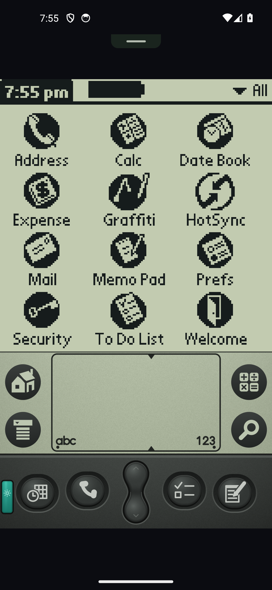<br>Palm IIIx</td>
    <td align="center">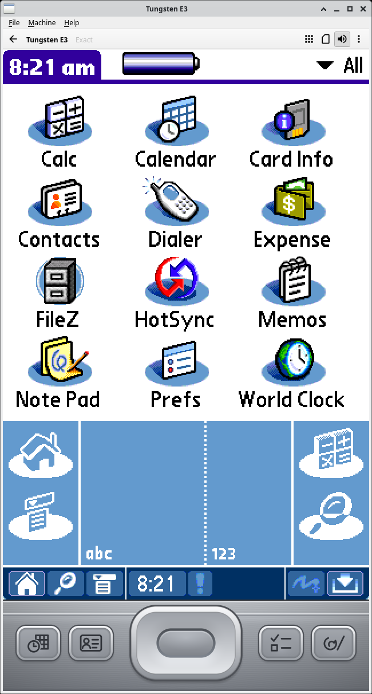<br>Tungsten E3, on Linux</td>
    <td align="center">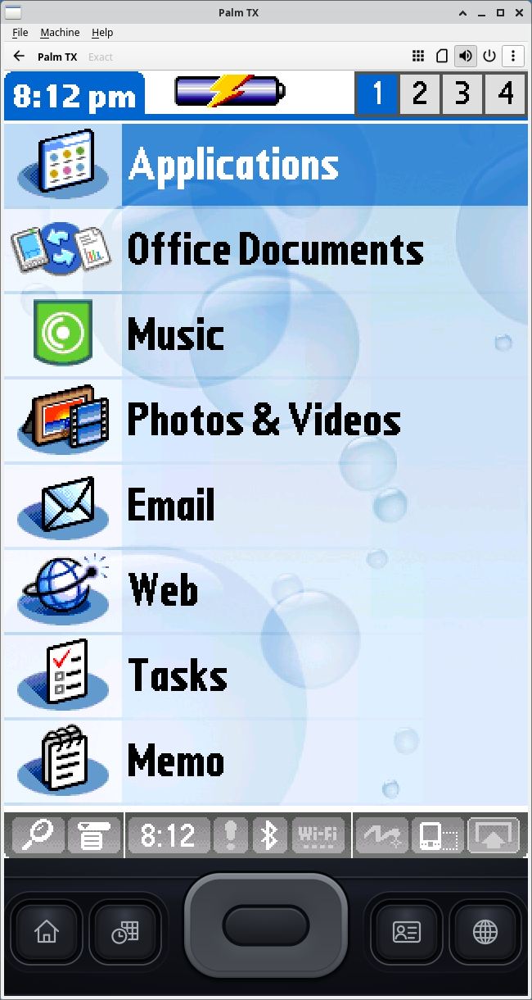<br>Palm T|X, on Linux</td>
    <td align="center"><br>Devices</td>
  </tr>
  <tr>
    <td align="center" colspan="2">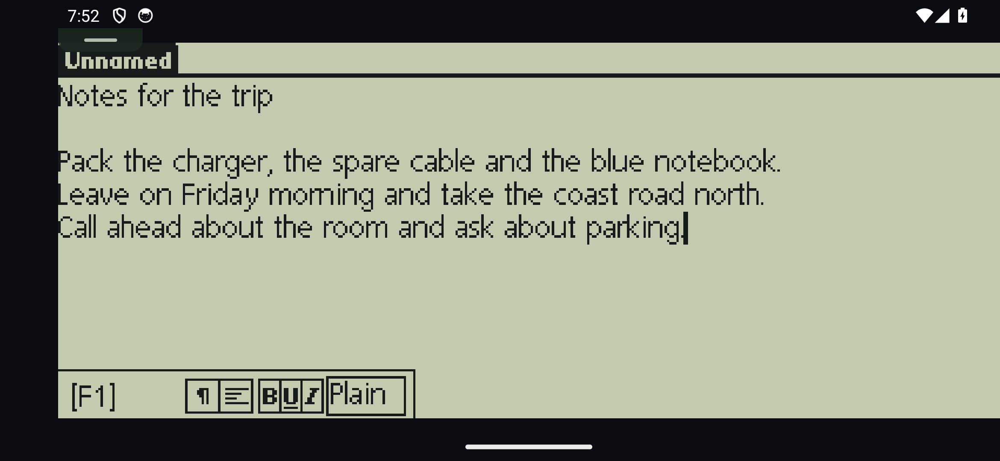<br>AlphaSmart Dana, on Android</td>
    <td align="center" colspan="2">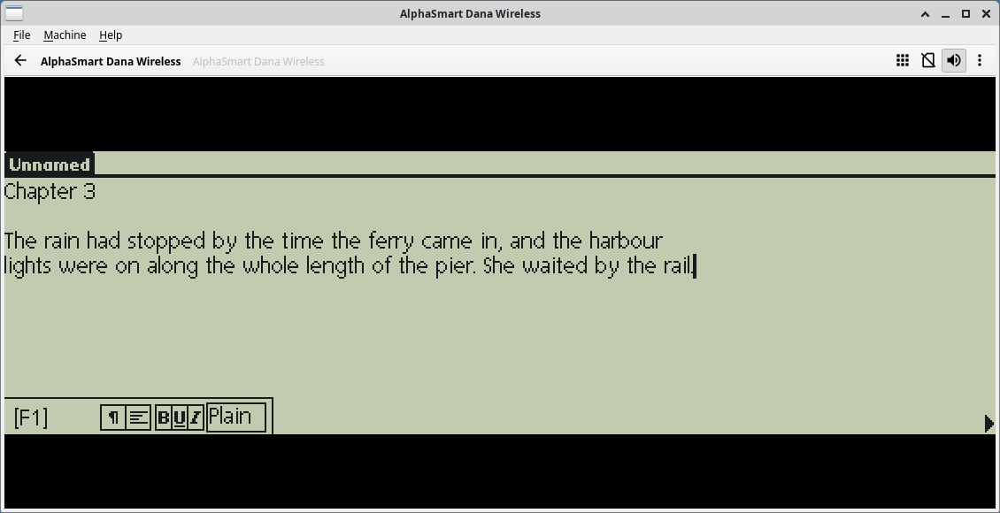<br>Dana Wireless, on Linux</td>
  </tr>
</table>

- [Devices](#devices)
- [Sessions](#sessions)
- [Screen](#screen)
- [Settings](#settings)
- [Buttons](#buttons)
- [Apps and cards](#apps-and-cards)
- [Peripherals](#peripherals)
- [Connections](#connections)
- [Modem and phones](#modem-and-phones)
- [Printing](#printing)
- [The Dana](#the-dana)
- [Low-latency audio](#low-latency-audio)
- [For developers](#for-developers)
- [Documentation](#documentation)
- [Installing](#installing)
- [Firmware](#firmware)
- [Building](#building)
- [Testing](#testing)
- [Licence](#licence)

## Devices

| Device | CPU | Card | Engine |
|---|---|---|---|
| Palm T\|X | ARM, 312 MHz | SD | Exact or Fast |
| Tungsten E2 | ARM, 200 MHz | SD | Exact or Fast |
| Tungsten E3 | ARM, 200 MHz (the E2 board) | SD | Exact or Fast |
| Zire 72 | ARM, 312 MHz | SD | Exact or Fast |
| Sony CLIÉ TG50 | ARM, 200 MHz | Memory Stick, Memory Stick Pro | Exact or Fast |
| Palm IIIx | 68k DragonBall EZ, 16.58 MHz | none | Exact |
| AlphaSmart Dana | 68k DragonBall VZ | two SD or MMC | Exact |
| AlphaSmart Dana Wireless | 68k DragonBall VZ | two SD or MMC | Exact |

The Tungsten E3 is the modified E2 ROM with a 320×480 screen. Its ROM has no Bluetooth stack, so it has no Bluetooth, mobile phone or dial-up.

The T|X plays videos in Media. On a slower computer use the Fast engine for it.

## Sessions


Each Palm you run is a session on the home screen, where you can rename, duplicate, export, import and delete them. There's no autosave, so a crash loses anything since the last save. On Linux closing the window saves it, Save and Stop goes back to the list and Save a copy… keeps a separate snapshot. Sessions have your firmware and personal data in them, so keep them to yourself.

Hard reset erases the Palm, and Save first saves it before you do. The T|X, E2 and IIIx ask first (press up to erase), the Zire erases straight away.

## Screen


On Linux pick a scale from 1× to 2× in 0.25 steps, it starts at the largest that fits. On Android the screen fits the phone, in whole steps or filling it, and follows the phone or stays in portrait or landscape. Pixels stay sharp, or turn on Smooth pixels to soften them.

While a machine runs, the bar along the top has Applications, Storage, Sound, Power and a menu with the rest. On Linux, Applications, Storage, Display and Connections open as a panel beside the Palm. On Android they open as a sheet, and Hide bar leaves a small handle at the top.

## Settings

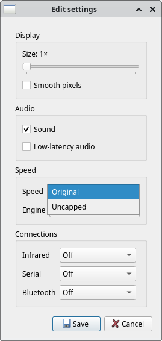

Each machine has its own display, sound, speed and connection settings. Set them when you add it, or with Edit settings while it's stopped. On Android most are in the Display sheet while it runs too.

- Speed is Original or Uncapped. Original runs the machine at its real speed, and Uncapped lets your computer or phone run it as fast as it can.
- Engine is Exact or Fast. Fast is the JIT, and the 68k machines (IIIx and both Danas) only have Exact.

See [Settings](doc/using-frond.md#settings).

## Buttons

The buttons under the screen and the silkscreens can be clicked or tapped. On a keyboard the arrow keys are the five-way, Enter selects and F1 to F4 are the app buttons. Help → Hardware Keyboard Controls lists the rest. On Android game controllers press the Palm's buttons, and you can change which does what in Settings.

The TG50 has its keyboard, jog wheel, Home, Back and Hold. Hold locks the controls and turns off the screen, and audio keeps playing.

You can also type with an emulated Palm infrared keyboard, if Palm's keyboard driver is installed.

## Apps and cards

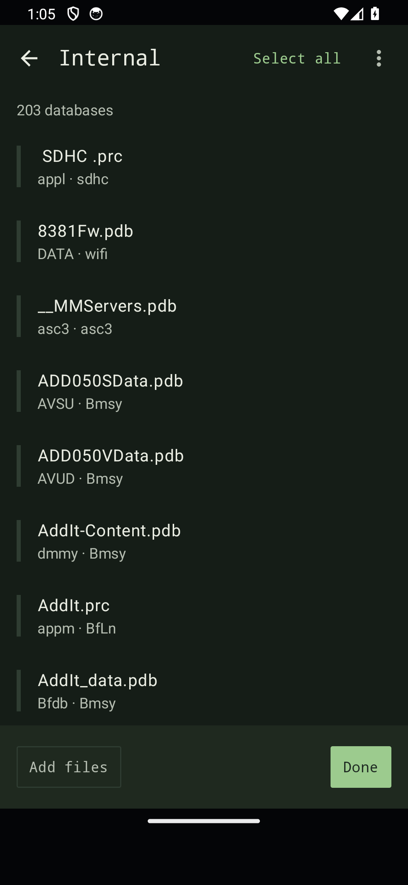

Install PRC and PDB files with Install…, in the Applications panel on Linux or sheet on Android. Launch, Export and Delete are on each app's row.

Cards are kept in a Cards drawer and sit in one machine at a time. Frond makes and imports SD card images up to 2 GB (1 GB on the E2 and E3), and Files copies files between your computer or phone and the card. Close any files on the Palm before ejecting. Files also opens the Palm's own databases, under Internal.

The TG50 takes a Memory Stick from 4 to 128 MB, or a Memory Stick Pro from 256 MB to 2 GB. Files copies files and folders to and from it, and Sony Launcher runs apps from its Card category. See [Storage cards](doc/using-frond.md#storage-cards).

## Peripherals

| | T\|X | E2 | E3 | Zire 72 | TG50 | IIIx | Dana | Dana Wireless |
|---|---|---|---|---|---|---|---|---|
| Sound | yes | yes | yes | yes | yes | piezo | yes | yes |
| Microphone | | | | yes | yes | | | |
| Wi-Fi, onto the internet through your computer or phone | virtual | | | | | | USB adapter | built in |
| Cradle serial port, to a PTY or TCP port for terminal programs and [HotSync](doc/using-frond.md#serial-port) | yes | yes | yes | | yes | yes | | |
| HotSync button, like the cradle's | yes | yes | yes | | | yes | | |
| USB HotSync over a PTY or TCP port | yes | yes | yes | yes | yes | | | |
| USB printer | | | | | | | yes | yes |
| [Infrared beaming](doc/using-frond.md#infrared) between Frond machines | yes | yes | yes | yes | yes | yes | yes | yes |
| [Printing over infrared](doc/using-frond.md#printing-over-infrared) | yes | yes | yes | yes | yes | yes | yes | yes |
| Infrared keyboard | yes | yes | yes | yes | yes | | | |
| [Virtual Bluetooth](doc/using-frond.md#bluetooth), with a local provider you start yourself | yes | yes | | yes | yes | | | |
| [Dial-up modem](doc/using-frond.md#dial-up-modem) and [HotSync by modem](doc/using-frond.md#hotsync-by-modem) | | | | | | yes | | |
| [Mobile phone over infrared](doc/using-frond.md#mobile-phone-over-infrared) | yes | yes | | yes | yes | yes | | |
| [Mobile phone over Bluetooth](doc/using-frond.md#mobile-phone-over-bluetooth) | yes | yes | | yes | yes | | | |

Anything else stays greyed out until it's done, like the E2's and Zire's networking and the Zire's camera. The Zire 72 has no serial port, as on the real one. Mobile phone over Bluetooth and HotSync by modem are Linux only for now.

The Palm IIIx (Palm OS 3.1, 68k DragonBall EZ) runs in its own runner, `frond-68k`. It has sound, backlight, serial with the HotSync button, infrared and the screen contrast, and no SD, USB, Bluetooth or Wi-Fi, as on the real one. Networking is PPP over the serial port or the dial-up modem, see [Palm IIIx serial and PPP](doc/using-frond.md#palm-iiix-serial-and-ppp). Android has it too, and the debugger works with prc-tools' gdb, see [Palm IIIx](doc/developer-reference.md#palm-iiix-frond-68k).

The infrared keyboard and beaming share the port, so take the keyboard off before turning beaming on. On Android infrared, Bluetooth, serial, USB HotSync and the gdb server go over the network, to another Frond or to `tools/link-irda.py`, `tools/link-bluetooth.py` and `tools/link-pty.py` (for pilot-link) on a computer.

The TG50 plays beeps, alarms and Sony Voice Recorder audio. Its microphone is off each time it starts, and saving, stopping or going to the background turns it off again. Android asks for permission the first time. Bluetooth is tested with serial (SPP) and object exchange. Its early Palm OS 5 has no SndStream, as on the real one, so apps like SunVox need Modern Clie Audio 2 installed first. The remote control, MagicGate and Memory Stick audio aren't there yet.

## Connections

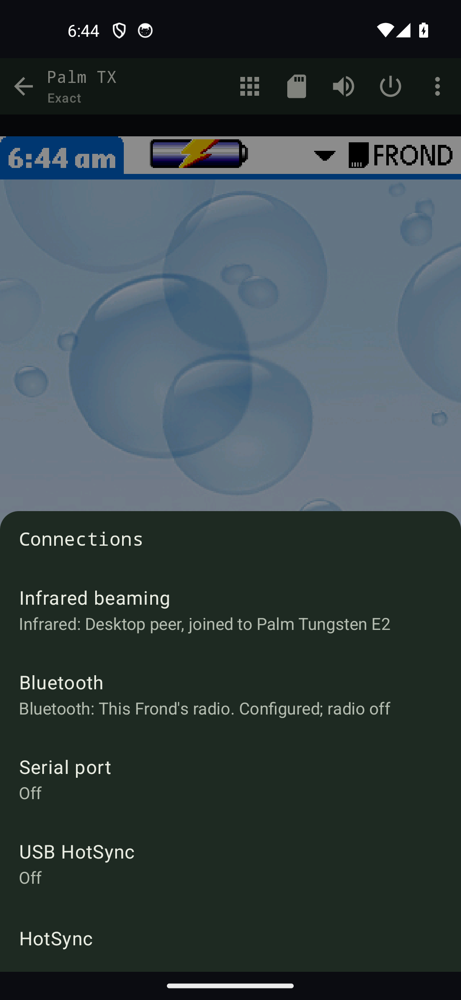

Two Frond installs on the same network can be paired once, and then a machine's Infrared, Serial or Bluetooth setting can name the other install. The two Palms then talk to each other, for example beaming a memo from a Tungsten E2 on a phone to a T|X on your computer. On Linux, This computer joins machines in different windows on the same computer. See [Connections between Fronds](doc/using-frond.md#connections-between-fronds).

## Modem and phones

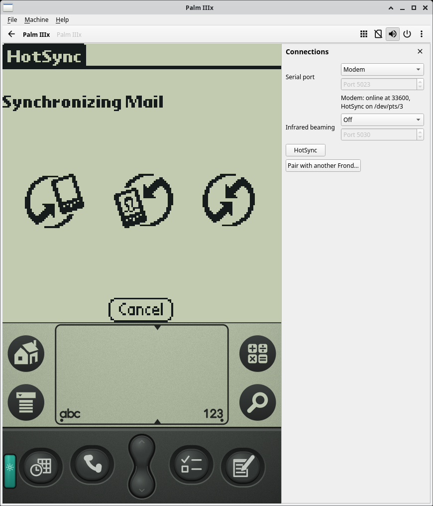

The Palm IIIx has a snap-on modem on its serial port. Frond answers as a modem on a 33600 line and puts you on the internet through your computer's or phone's connection, and any number you dial connects. On Linux the modem can also HotSync with pilot-link, by dialling 4687962 or over Network HotSync.

The T|X, E2, Zire 72 and TG50 can dial out through a mobile phone over infrared, and on Linux over Bluetooth, with the same modem and internet. The IIIx can use the infrared phone too, on Palm OS 3.5 and 4.1. See [Dial-up modem](doc/using-frond.md#dial-up-modem).

## Printing

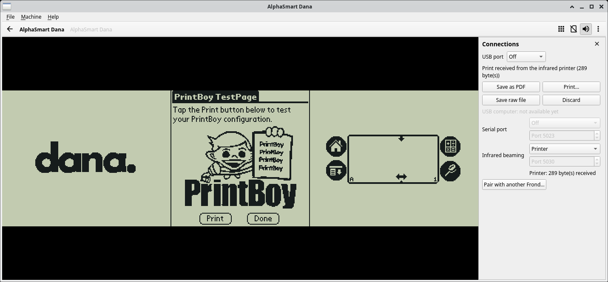

Pick Printer in a machine's Infrared list and print apps see "Frond Printer" over IrDA. The Dana and Dana Wireless can also print to a USB printer. When a print stops, "Print received" shows, then choose Save as PDF (Linux), Print, Save raw file or Discard. Only the Generic printer profile can be shown as pages, so for a printer's own language (PCL, ESC/P) use Save raw file. See [Printing over infrared](doc/using-frond.md#printing-over-infrared).

## The Dana

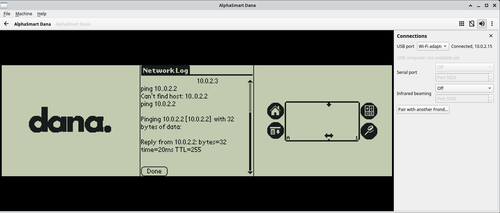

The AlphaSmart Dana has its wide screen, built-in keyboard, sound, infrared and two SD or MMC slots. Zoom in, or pick Fit to see the whole screen, and the onscreen keyboard can be compact, full or hidden.

Its USB port takes a printer or a USB 802.11b adapter, and the Dana Wireless has the Wi-Fi built in. Make an 802.11b service in the Dana's Network preferences and connect to `Frond`, and the Dana gets on the internet through your computer or phone. See [Dana USB port](doc/using-frond.md#dana-usb-port).

Peer to Peer (ad hoc) Wi-Fi finds nobody, and the USB computer controls stay greyed out. On Android a Dana session with cards in it can't be copied or imported yet, but each card can be exported.

## Low-latency audio

Off by default. On the T|X, E2, E3 and Zire 72 it plays one 44.1 kHz stereo stream with less delay, for music apps like SunVox, and drops back to the normal path when your computer or phone can't keep up. On the TG50, and these with other firmware, it keeps a shorter audio queue while sound plays, about 35 ms less delay. See [Low-latency audio](doc/using-frond.md#low-latency-audio).

## For developers

- The [developer runner](doc/developer-reference.md#developer-runner) installs and launches apps, exports RAM databases and fetches logs from the command line.
- The [debugger](doc/developer-reference.md#gdb-and-pace-monitor) works with GDB: ARM and Thumb stepping, breakpoints, PACE inspection and 68k stepping, no watchpoints yet. On Android turn on the gdb server in Settings.
- [Compatibility tests](doc/testing.md#real-firmware-checks) check apps launch, take input, keep their data and restore.
- [Input and audio timing](doc/performance.md#input-and-menu-latency) tools measure latency.

## Documentation

- [Using Frond](doc/using-frond.md) covers machines, settings, keys, cards and connections.
- [Developer reference](doc/developer-reference.md) has the command line, console, control socket, replay files, GDB and environment variables.
- [Testing](doc/testing.md) lists the test levels and what each one needs.
- [Performance](doc/performance.md) covers the engines, benchmarks and latency tools.
- [Adding a device](doc/adding-a-device.md) explains profiles, bring-up and button bar art.

---

## Installing

### Android

Android 8 or newer. Add [my F-Droid repo](https://hunke.ws/fdroid/repo?fingerprint=80438B253C257BCCE05CDCB9E3AC9B6174C2250659962B14FCBE7F32FD42D53E), then search for Frond. F-Droid offers new versions as updates.

Or get the APK from [Releases](https://github.com/roge-rm/frond/releases).

### Linux

On Debian 13 (Trixie) and the 64-bit Raspberry Pi OS based on it, the easiest way is my apt repo, so it updates with the rest of the system. Add it once:

```
sudo curl -fsSLo /etc/apt/keyrings/hunke.asc https://hunke.ws/apt/hunke.asc
echo "deb [signed-by=/etc/apt/keyrings/hunke.asc] https://hunke.ws/apt stable main" | sudo tee /etc/apt/sources.list.d/hunke.list
sudo apt update
```

Then `sudo apt install frond`. It shows up in the application menu.

Or get the `.deb` for your machine, amd64 or arm64, from [Releases](https://github.com/roge-rm/frond/releases) and install it with `sudo apt install ./frond_*.deb`.

On other distributions get the AppImage for x86_64 or aarch64 from [Releases](https://github.com/roge-rm/frond/releases), make it executable and run it. It needs a fairly recent distribution, Debian 12 or Ubuntu 22.10 or newer.

It needs FUSE, which most desktops have. If it won't start, install `fuse3`, or run it with `--appimage-extract-and-run`.

## Firmware

| Device | NOR | NAND |
|---|---|---|
| Palm T\|X | 16 MiB | 132 MiB raw dump, with spare bytes |
| Tungsten E2 | 8 MiB | 34,603,008 bytes raw dump, optional |
| Tungsten E3 | the modified 8 MiB E2 ROM | optional |
| Zire 72 | 14,942,208 bytes | none |
| Sony CLIÉ TG50 | 13,041,664 bytes | none |
| Palm IIIx | one ROM file, 1.2 to 1.7 MB | none |
| AlphaSmart Dana and Dana Wireless | one ROM file, 6 MiB | none |

The IIIx takes the OS 3.1 ROM (retail or debug), a generic OS 3.5 EZ ROM (retail or debug), or the IIIx/V OS 4.1 ROM. Both Danas use the same ROM, so choose AlphaSmart Dana Wireless when you add one, as the ROM itself says Dana.


Frond works out the device from the NOR and never changes your files. On Linux use File → Firmware… or Add device, on Android import them when you add a device. Go through Palm OS setup the first time, and if taps land in the wrong spot, calibrate the screen in Prefs.

## Building

On Debian 13 (Trixie):

```sh
sudo apt install git build-essential python3 cmake ninja-build libboost-dev qt6-base-dev qt6-wayland \
  libsdl2-dev libsdl2-image-dev libreadline-dev libcurl4-openssl-dev libslirp-dev pkg-config mtools
git clone --recurse-submodules https://github.com/roge-rm/frond.git
cd frond
make -j4
./out/frond-desktop
```

`make deb` builds a Debian package in `out/` instead, which also needs `dpkg-dev` and `binutils`. Neither the packages nor the APK have firmware or Palm apps in them.

The Android app is in `android/` and builds with Gradle (`./gradlew assembleDebug`).

The upstream core is pinned in `vendor/cloudpilot`, and the patches in `patches/` are applied to it in order in `build/source`. See [Testing](doc/testing.md).

## Testing

These need no firmware:

```sh
make test
QT_QPA_PLATFORM=offscreen make test-desktop
make test-build-tools check-reconstruction
```

---

## Licence

Frond is free software under the GNU General Public License, version 3 or later. See [LICENSE](LICENSE).

It's built on [CloudpilotEmu](https://github.com/cloudpilot-emu/cloudpilot-emu) (its execution core, PACE support and SDL frontend) and Dmitry Grinberg's [uARM](https://github.com/uARM-Palm/uARM) TX board model. Thanks to their authors.

Palm firmware and apps have their own licences and you need to supply them yourself.
