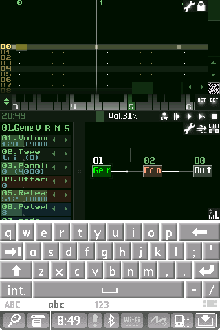
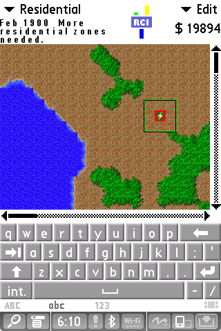

# Frond

Frond runs Palm OS 5 on Linux, with a Palm TX on your desktop. It's built on
[CloudpilotEmu](https://github.com/cloudpilot-emu/cloudpilot-emu) and
[uARM](https://github.com/uARM-Palm/uARM), with a Qt launcher and work on the TX's
hardware, sound and input.

You can install Palm apps, use virtual SD cards, and close the emulator and come
back to where you left it. SunVox plays through its native ARM sound callbacks,
and SimCity runs too.

It's early, at version 0.2.0. Sound can break up when the host is busy, and some
menus are slow. The launcher and Palm screen are separate windows for now.
You'll need your own TX firmware; none is included.

If you try it, let me know what works and what doesn't, or open an issue here.

Enjoy!<br>
Dan

 

## Build and run

On Debian 13 (trixie):

```sh
sudo apt install git build-essential python3 cmake qt6-base-dev qt6-wayland \
  libsdl2-dev libsdl2-image-dev libreadline-dev libcurl4-openssl-dev libslirp-dev pkg-config mtools
git clone --recurse-submodules https://github.com/roge-rm/frond.git
cd frond
make -j4
./out/frond-desktop
```

In the launcher, choose your TX NOR and NAND images, then click **Start**. Frond
expects a 16 MiB NOR and a 132 MiB raw NAND dump, including spare bytes. It reads
the files into memory and leaves the originals alone.

Complete Palm OS setup in the Palm window. If taps land in the wrong place,
calibrate the touchscreen in Preferences. Use **File → Install Application** to
install PRC or PDB files, then open them from the Palm launcher.

Use the clickable controls below the Palm screen for the four app buttons and
five-way navigator. They follow Palm OS button assignments.

The desktop build targets Debian trixie with KDE Plasma. Other Linux desktops
may work too. See the [desktop guide](doc/desktop.md) for settings and the command
line interface.

## Saving

Close either window to save the running Palm. Next time, Frond resumes it if
**Resume last session on startup** is checked. **Save and Stop** saves and returns
to the launcher instead.

Working sessions go in `~/.local/share/frond/sessions`, or under your
`XDG_DATA_HOME`. Imported sessions get their own working copy. **Save a Copy**
writes a separate snapshot you can return to later.

A session includes the firmware, installed apps, RAM, flash and virtual SD card.
Keep it somewhere private if it contains personal data. Saving happens on normal
close; there isn't a periodic autosave, so a crash can lose changes since the
last save.

## SD cards and networking

The **SD Card** menu creates 32, 64 or 128 MiB FAT16 cards. You can also import an
image, eject and reinsert a card, or export it. Card contents and insertion state
are saved with the session. Close files on the Palm before ejecting. **Exchange Files…** copies files between
the host and an ejected card using `mtools`, without mounting it or running Frond
as root. It saves a recovery session and edits a private image; choose **Apply
and Reinsert** to use the edits. Existing filenames are refused. See the
[file exchange guide](doc/peripherals.md#hostpalm-file-exchange).

Choose **Network: Virtual Wi-Fi (Frond)**, turn on Wi-Fi inside Palm OS and
connect to **Frond**. The Palm uses its own networking stack; the virtual router
provides DHCP, DNS and IPv4 Internet access through your computer. It needs no
root access, bridge setup or physical Wi-Fi adapter. Blazer can load HTTP pages;
old TLS and browser limitations still apply to modern sites.

The selector also keeps **Internet via host**, a smaller 68k NetLib forwarding
mode, and local echo/error fixtures. Wi-Fi state and the selected mode persist
with the session, but live Internet connections close on resume. Bluetooth,
USB/HotSync and host serial connections aren't supported yet. See the
[peripheral guide](doc/peripherals.md) for setup and limits.

## Computer keyboard

You can attach the computer keyboard as a Palm infrared keyboard. Check
**Attach Palm infrared keyboard** in the launcher, install and enable the Palm
keyboard driver, then type in the Palm window. It uses the accessory's scan codes
and the guest driver. See [keyboard setup](doc/peripherals.md#computer-keyboard)
for the driver and supported keys. In SunVox, `Z` and `X` play C and D through
the selected module.

## Sound

Normal playback uses SDL and your desktop's sound server. There's also an
[experimental fast audio option](doc/fast-audio.md) for one 44.1 kHz stereo stream
on the supported TX firmware. It reduces the guest audio queue's delay, but it
has a smaller buffer and can fall back to normal playback if the host can't keep
up. Start with normal sound.

## Debian package

To build and install a package locally:

```sh
make deb
sudo apt install ./out/frond_0.2.0-1_amd64.deb
```

It appears in Plasma's application menu as **Frond**. The package includes the
emulator, launcher and documentation, with no firmware or Palm apps.

## Development

```sh
make test
make test-desktop
```

The core tests use synthetic memory and device data, so they don't need Palm
firmware. The [application testing guide](doc/app-testing.md) covers tests that
use your own firmware and apps, and [input timing](doc/input-latency.md) describes
the optional tracing tools.

For a repeatable run using your TX firmware, see the
[boot and acceptance guide](doc/boot-check.md).

The [developer runner](doc/developer-run.md) installs several PRC/PDB files into a
private session copy, launches an app, runs replay, captures screenshots and
exports named databases with JSON status and time limits.

The [compatibility matrix](doc/compatibility.md) checks synthetic PACE/ARM programs
and optional Palm service/native probes, with fresh logs before and after session
restore. Physical TX comparison remains deferred.

The [ARM/Thumb and PACE debugger](doc/debugger.md) is available with `--gdb PORT`
on IPv4 loopback. It supports native registers, memory, stepping and address breakpoints;
PACE monitor commands add read-only 68k registers, address breakpoints and
exception snapshots. Active Palm app attribution, 68k stepping and watchpoints
are not implemented.

The upstream core is pinned in `vendor/cloudpilot`. Frond's core changes are
ordered patches in `patches/`; the build applies them to `build/source`.
If you edit that generated tree, export your changes back to a patch before
cleaning it. The [native core notes](doc/tx-native.md) explain the TX model and
performance tools.

## Credits and licence

Frond uses CloudpilotEmu's optimized execution core, PACE integration and SDL
frontend, and Dmitry Grinberg's uARM TX board model. Thanks to their authors for
the work this builds on. Existing copyright and third-party notices are kept.

GPL-3.0-or-later, see [LICENSE](LICENSE). Palm firmware and applications have
their own licences and must be supplied separately.
