# Frond

Frond is a PDA emulator for Linux and Android, for running apps and games and writing your own. There are builds for Windows and macOS too, untested.

It runs Palm OS devices from the Palm IIIx to the T|X, the Sony CLIÉs, the AlphaSmart Dana and the Tapwave Zodiac, and the HP iPAQ rx1950 on Windows Mobile 5, with sound, memory cards, infrared, Bluetooth, HotSync, ActiveSync, printing, networking and saved sessions. The table below shows what each one has. Some peripherals are still in progress and more devices are on the way.

It's built on [CloudpilotEmu](https://github.com/cloudpilot-emu/cloudpilot-emu) and [uARM](https://github.com/uARM-Palm/uARM). You need your own firmware for each device, none is included.

How it differs is by focussing on a couple of goals that are important to me - simulating peripherals to emulate the experience of actually using these devices and emulating them fast enough that they can be enjoyed on less than stellar hardware. These goals are achieved by simulating each offered connection and peripheral and finding ways to increase the speed of emulation - like the [dynarmic](https://github.com/lioncash/dynarmic) based JIT compiler that was added in 0.11.0.

You can run multiple devices on one computer (Linux only for now) - or multiple phones - and link them together over virtual infrared or Bluetooth, connect to the internet with a virtual modem or simulated WIFI connection, install an IR keyboard driver and work on your screenplay, etc. This project is fueled by nostalgia and I want to play with the things I remember, as I remember them, while also trying things I knew of back then but never saw in person.

Let me know what works, what doesn't, and what you'd like in #frond [on my discord](https://discord.gg/9Wun47jGC6) - or open an issue here.

Enjoy,<br>
Dan

---

<table>
  <tr>
    <td align="center">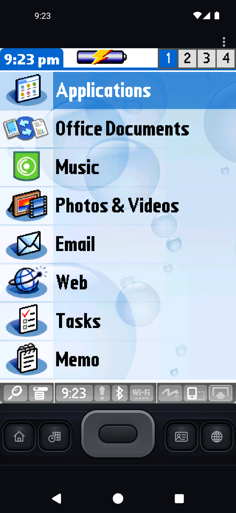<br>Palm T|X</td>
    <td align="center">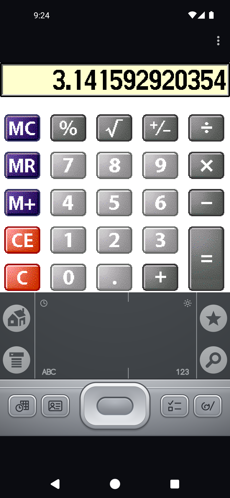<br>Tungsten E2</td>
    <td align="center">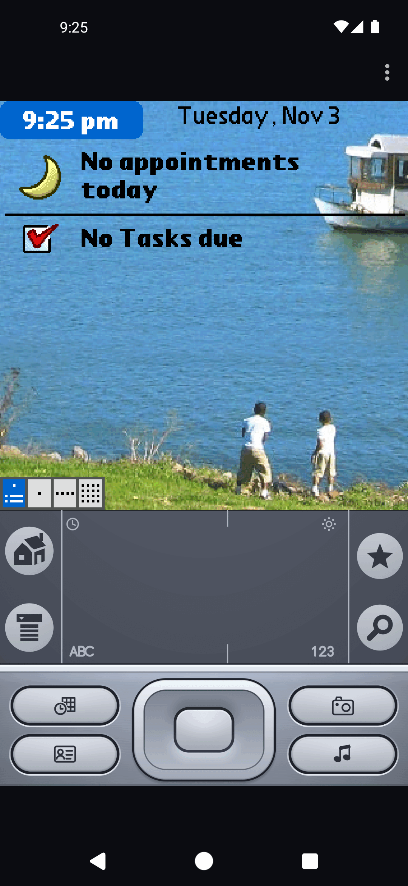<br>Zire 72</td>
    <td align="center">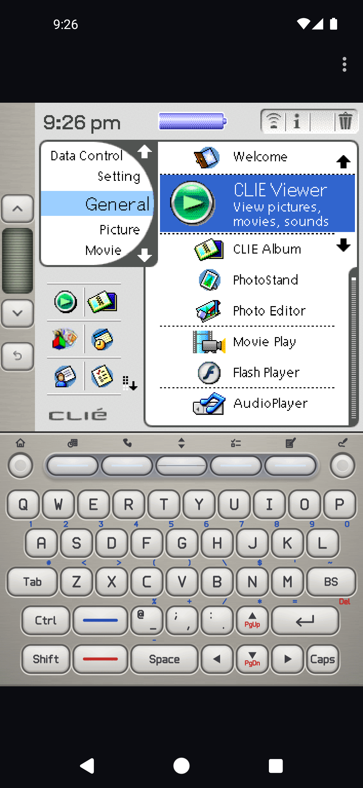<br>CLIÉ TG50</td>
  </tr>
  <tr>
    <td align="center">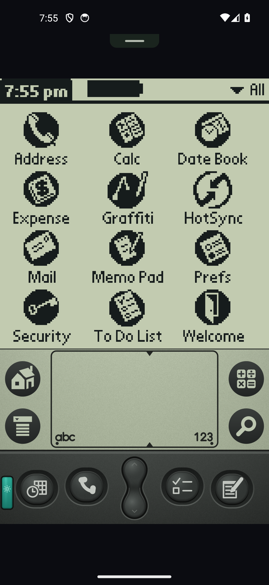<br>Palm IIIx</td>
    <td align="center">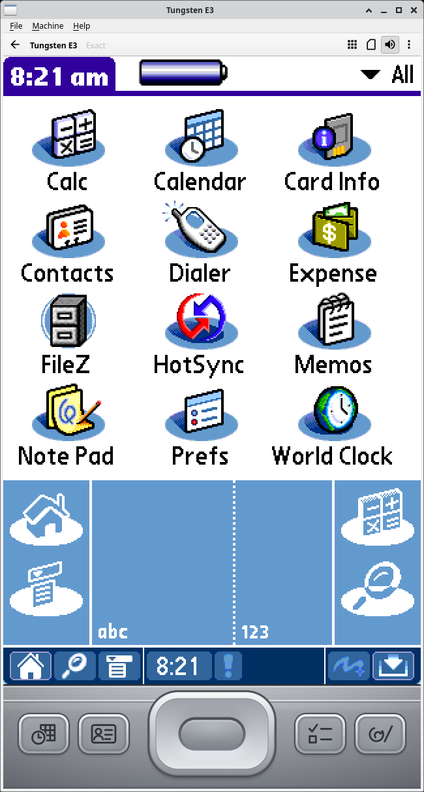<br>Tungsten E3, on Linux</td>
    <td align="center">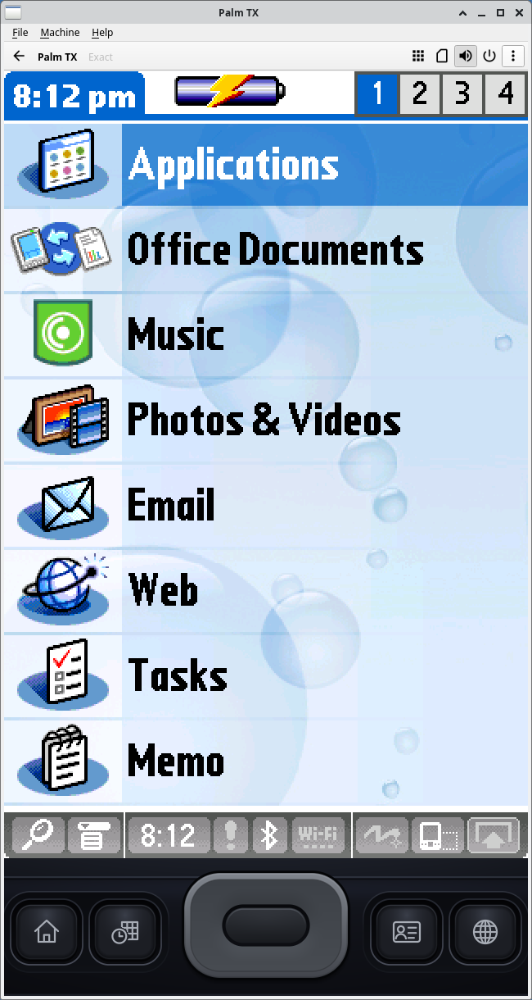<br>Palm T|X, on Linux</td>
    <td align="center">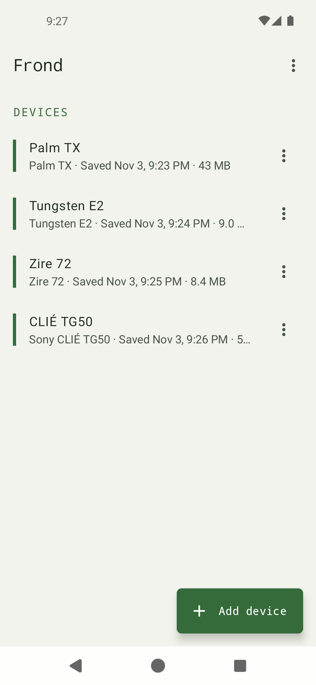<br>Devices</td>
  </tr>
  <tr>
    <td align="center" colspan="2">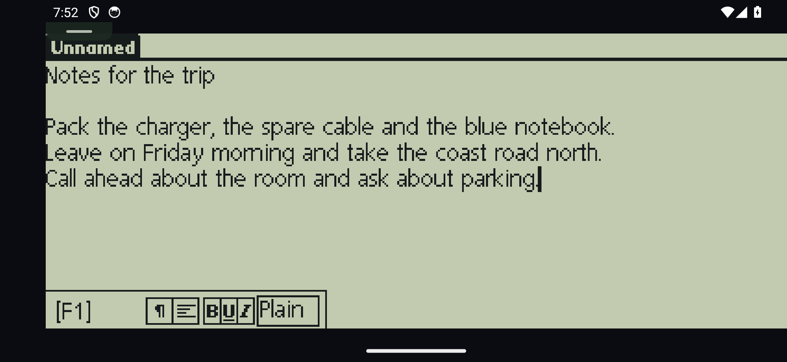<br>AlphaSmart Dana, on Android</td>
    <td align="center" colspan="2">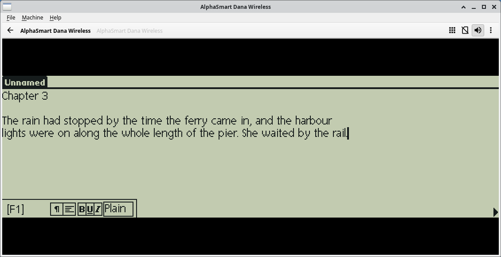<br>Dana Wireless, on Linux</td>
  </tr>
  <tr>
    <td align="center" colspan="3">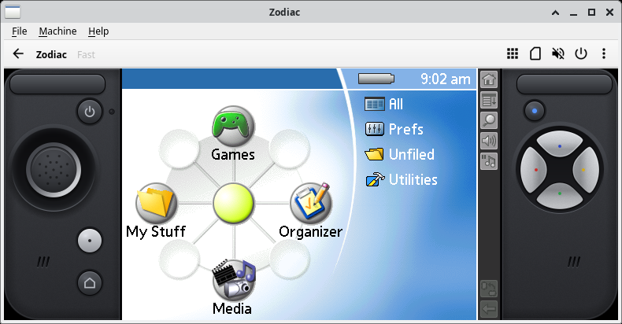<br>Tapwave Zodiac, on Linux</td>
    <td align="center">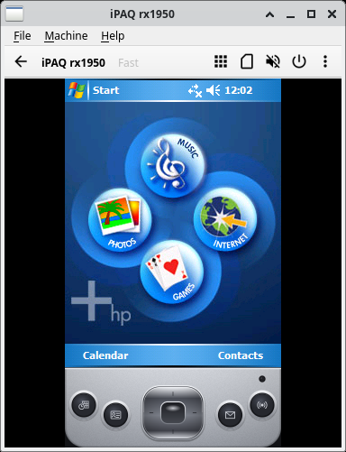<br>iPAQ rx1950, on Linux</td>
  </tr>
</table>

- [Devices](#devices)
- [Getting started](#getting-started)
  - [Installing](#installing)
  - [Firmware](#firmware)
  - [Your first machine](#your-first-machine)
- [What it does](#what-it-does)
- [For developers](#for-developers)
  - [Building](#building)
  - [Testing](#testing)
- [Documentation](#documentation)
- [Licence](#licence)
- [Special Thanks](#special-thanks)

## Devices

| Device | OS | Screen | Card | [Sound](doc/using-frond.md#settings) | [IR](doc/using-frond.md#infrared) | [Bluetooth](doc/using-frond.md#bluetooth) | [Net](doc/using-frond.md#network) | [HotSync](doc/using-frond.md#serial-port) |
|---|---|---|---|---|---|---|---|---|
| **Palm OS 5, ARM** | | | | | | | | |
| Palm T\|X | 5.4 | 320×480 colour | SD | yes | yes | yes | virtual Wi-Fi | USB, serial |
| Tungsten E2 | 5.4 | 320×320 colour | SD | yes | yes | yes | | USB, serial |
| Tungsten E3 | 5.4 | 320×480 colour | SD | yes | yes | | | USB, serial |
| Zire 72 | 5.2 | 320×320 colour | SD | yes | yes | yes | | USB |
| Sony CLIÉ TG50 | 5.0 | 320×320 colour | Memory Stick | yes | yes | yes | | USB, serial |
| Tapwave Zodiac | 5.2 | 480×320 colour | two SD | yes | yes | yes | | USB, serial |
| **Palm OS 3 and 4, 68k** | | | | | | | | |
| Palm IIIx | 3.1, 3.5 or 4.1 | 160×160 grey | | piezo | yes | | PPP | serial |
| Palm IIIe | 3.1 | 160×160 grey | | piezo | yes | | PPP | serial |
| Palm IIIxe | 3.5 | 160×160 grey | | piezo | yes | | PPP | serial |
| Palm V | 3.1, 3.3 or 4.1 | 160×160 grey | | piezo | yes | | PPP | serial |
| Palm Vx | 3.3 or 4.1 | 160×160 grey | | piezo | yes | | PPP | serial |
| Palm IIIc | 4.1 | 160×160 colour | | piezo | yes | | PPP | serial |
| Palm m100, m105 | 3.5 | 160×160 grey | | piezo | yes | | PPP | serial |
| Palm m125 | 4.0 | 160×160 grey | SD or MMC | piezo | yes | | PPP | serial |
| Palm m130 | 4.0 | 160×160 colour | SD or MMC | piezo | yes | | PPP | serial |
| Palm m500 | 4.1 | 160×160 grey | SD or MMC | piezo | yes | | PPP | serial |
| IBM WorkPad c500 | 4.0 | 160×160 grey | SD or MMC | piezo | yes | | PPP | serial |
| Palm m505, m515 | 4.1 | 160×160 colour | SD or MMC | piezo | yes | | PPP | serial |
| Palm m520 | 4.1 | 320×320 colour | SD or MMC | piezo | yes | | PPP | serial |
| Sony CLIÉ T415 | 4.1 | 320×320 grey | Memory Stick | yes | yes | | PPP | USB |
| **Other** | | | | | | | | |
| AlphaSmart Dana | 4.1 | 560×160 grey | two SD or MMC | yes | yes | | USB Wi-Fi adapter | |
| AlphaSmart Dana Wireless | 4.1 | 560×160 grey | two SD or MMC | yes | yes | | built in | |
| **Windows Mobile, ARM** | | | | | | | | |
| HP iPAQ rx1950 | Windows Mobile 5 | 240×320 colour | SD | yes | yes | | virtual Wi-Fi | ActiveSync, USB and serial |

- The ARM devices have two engines. Exact runs the device exactly and Fast is a JIT that runs quicker on a slow computer or phone. Pick one in each machine's [Settings](doc/using-frond.md#settings).
- The 68k devices, from the Palm IIIx to the m520, the Danas and the CLIÉ T415, run in their own runner, `frond-68k`, with the Exact engine only. Their networking is PPP over serial or the dial-up modem, see [68k Palm serial and PPP](doc/using-frond.md#68k-palm-serial-and-ppp).
- The iPAQ rx1950 runs Windows Mobile 5. It installs CABs from its SD card and syncs over [ActiveSync](doc/using-frond.md#activesync).

What each device has, and what isn't done yet, is in [Availability and limits](doc/using-frond.md#availability-and-limits) and its [Device notes](doc/using-frond.md#device-notes).

## Getting started

### Installing

#### Android

Android 8 or newer. Add [my F-Droid repo](https://hunke.ws/fdroid/repo?fingerprint=80438B253C257BCCE05CDCB9E3AC9B6174C2250659962B14FCBE7F32FD42D53E), then search for Frond. F-Droid offers new versions as updates.

Or get the APK from [Releases](https://github.com/roge-rm/frond/releases).

#### Linux

On Debian 13 (Trixie) and the 64-bit Raspberry Pi OS based on it, the easiest way is my apt repo, so it updates with the rest of the system. Add it once:

```
sudo curl -fsSLo /etc/apt/keyrings/hunke.asc https://hunke.ws/apt/hunke.asc
echo "deb [signed-by=/etc/apt/keyrings/hunke.asc] https://hunke.ws/apt stable main" | sudo tee /etc/apt/sources.list.d/hunke.list
sudo apt update
```

Then `sudo apt install frond`. It shows up in the application menu.

Or get the `.deb` for your machine, amd64 or arm64, from [Releases](https://github.com/roge-rm/frond/releases) and install it with `sudo apt install ./frond_*.deb`.

On other distributions get the AppImage for x86_64 or aarch64 from [Releases](https://github.com/roge-rm/frond/releases), make it executable and run it. It needs a fairly recent distribution, Debian 12 or Ubuntu 22.10 or newer.

It needs FUSE, which most desktops have. If it won't start, install `fuse3`, or run it with `--appimage-extract-and-run`.

#### Windows and macOS

These builds are made as is and I haven't tried them. Get them from [Releases](https://github.com/roge-rm/frond/releases): the installer (`Frond-*-setup.exe`) or the zip for 64-bit Windows, and the dmg for an Apple silicon or Intel Mac. They aren't signed, so Windows asks before running the installer, and on a Mac you right-click Frond and pick Open the first time. Host serial ports, the NetLib redirect, Bluetooth between machines on one computer, 68k HostLink and the debugger aren't in these builds yet.

### Firmware

| Device | NOR | NAND |
|---|---|---|
| Palm T\|X | 16 MiB | 132 MiB raw dump, with spare bytes |
| Tungsten E2 | 8 MiB | 34,603,008 bytes raw dump, optional |
| Tungsten E3 | the modified 8 MiB E2 ROM | optional |
| Zire 72 | 14,942,208 bytes | none |
| Sony CLIÉ TG50 | 13,041,664 bytes | none |
| Tapwave Zodiac | the 8,192,000 byte ROM, or Tapwave's Zodiac 1.1 update (the zip or the PRC in it) | none |
| Palm IIIx, IIIe, IIIxe, IIIc, V, Vx, m100 and m105 | one ROM file, 1.2 to 2.1 MB | none |
| Palm m125, m130, m500, m505, m515, m520 and IBM WorkPad c500 | one ROM file, 2.4 to 4.2 MB | none |
| AlphaSmart Dana and Dana Wireless | one ROM file, 6 MiB | none |
| HP iPAQ rx1950 | `CEBL.nbf` from HP's WM5 ROM 1.01.00 ENG (264,794 bytes) | OS image: `CEOS.nbf` from the same ROM (67,095,130 bytes), or another OS `.nbf` |

Frond works out the device from the NOR and never changes your files. Which ROM each 68k device and the Zodiac take is in [Firmware and machines](doc/using-frond.md#firmware-and-machines).

### Your first machine

On Linux use File → Firmware… or Add device, on Android import the firmware when you add a device. Add device starts a new machine with its own settings. Go through the device's own setup the first time. If taps land in the wrong spot, calibrate the screen in Prefs on Palm OS, or Settings, System, Screen on Windows Mobile.

## What it does

- Sessions: each machine is a session you can rename, duplicate, export, import or delete. There's no autosave, so save often. See [Running a machine](doc/using-frond.md#running-a-machine).
- Screen and buttons: the screen scales to fit and stays sharp. Use the device's buttons and silkscreen, your keyboard or a game controller. See [Buttons, keys and controllers](doc/using-frond.md#buttons-keys-and-controllers).
- Settings: each machine has its own display, sound, battery, speed and engine. Speed goes from Original, the real device's speed, up to Uncapped. See [Settings](doc/using-frond.md#settings).
- Apps and cards: install PRC and PDB files, or CABs on the rx1950. Cards live in a drawer, and Files copies to and from them. See [Apps](doc/using-frond.md#apps) and [Storage cards](doc/using-frond.md#storage-cards).
- Connections: infrared, Bluetooth and serial link machines on one computer or on paired Fronds on your network. On Linux serial and USB also go to a PTY or TCP port. See [Connections](doc/using-frond.md#connections).
- Modem and phones: the 68k Palms have a snap-on modem, and most ARM Palm OS devices dial through a mobile phone over infrared or Bluetooth, onto the internet. See [Dial-up modem](doc/using-frond.md#dial-up-modem).
- Printing: every device with infrared prints to "Frond Printer", and the Danas to a USB printer, as a PDF or a raw file. See [Printing over infrared](doc/using-frond.md#printing-over-infrared).
- Low-latency audio: less delay between a tap and the sound, for music apps like SunVox. See [Low-latency audio](doc/using-frond.md#low-latency-audio).
- HotSync and ActiveSync: [Sync Manager](doc/using-frond.md#sync-manager) syncs contacts, calendar, tasks and memos on supported Palm OS devices. [External HotSync](doc/using-frond.md#usb-hotsync) and [ActiveSync](doc/using-frond.md#activesync) can use pilot-link and SynCE.

## For developers

- The [developer runner](doc/developer-reference.md#developer-runner) installs and launches apps, exports RAM databases and fetches logs from the command line.
- The [debugger](doc/developer-reference.md#gdb-and-pace-monitor) works with GDB: ARM and Thumb stepping, breakpoints, PACE inspection and 68k stepping, no watchpoints yet. On Android turn on the gdb server in Settings.
- [Compatibility tests](doc/testing.md#real-firmware-checks) check apps launch, take input, keep their data and restore.
- [Input and audio timing](doc/performance.md#input-and-menu-latency) tools measure latency.
- [Developer reference](doc/developer-reference.md) has the command line, console, control socket, replay files, GDB and environment variables.
- [Testing](doc/testing.md) lists the test levels and what each one needs.
- [Performance](doc/performance.md) covers the engines, benchmarks and latency tools.
- [Adding a device](doc/adding-a-device.md) explains profiles, bring-up and button bar art.

### Building

On Debian 13 (Trixie):

```sh
sudo apt install git build-essential python3 cmake ninja-build libboost-dev qt6-base-dev qt6-wayland \
  libsdl2-dev libsdl2-image-dev libreadline-dev libcurl4-openssl-dev libslirp-dev libasound2-dev pkg-config mtools
git clone https://github.com/roge-rm/frond.git
cd frond
make -j4
./out/frond-desktop
```

`make deb` builds a Debian package in `out/` instead, which also needs `dpkg-dev` and `binutils`. Neither the packages nor the APK have firmware or apps in them.

The Android app is in `android/` and builds with Gradle (`./gradlew assembleDebug`).

The core is in `core/` (based on CloudpilotEmu) and Dynarmic is in `vendor/dynarmic`. See [Testing](doc/testing.md).

### Testing

These need no firmware:

```sh
make test
QT_QPA_PLATFORM=offscreen make test-desktop
make test-build-tools
```

## Documentation

- [Using Frond](doc/using-frond.md) covers machines, settings, keys, cards and connections.

---

## Licence

Frond is free software under the GNU General Public License, version 3 or later. See [LICENSE](LICENSE).

It's built on [CloudpilotEmu](https://github.com/cloudpilot-emu/cloudpilot-emu) (its execution core, PACE support and SDL frontend) and Dmitry Grinberg's [uARM](https://github.com/uARM-Palm/uARM) TX board model. Thanks to their authors.

The firmware and apps for these devices have their own licences and you need to supply them yourself.

## Special Thanks

Frond started as a solo project but grew almost right away and has turned into a small community project. 

Thank you to [palmtoplover777](https://github.com/dyharlan) especially as they have been a constant source of ideas, inspiration, hints, clues, and bug reports that have kept the project progressing. The Zodiac emulator would not have happened without their essential contributions.

Thank you as well to [Gadgetoid](https://github.com/Gadgetoid) for their help with YMF768 fidelity work.
