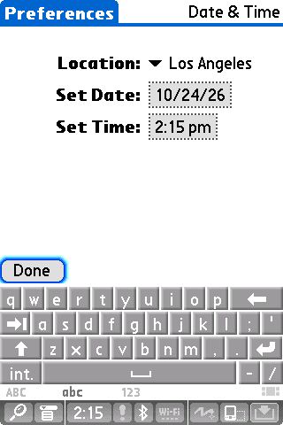

# Palm TX boot smoke test

Build with `make`, then run from the repository root with your own firmware:

```sh
SDL_VIDEODRIVER=dummy SDL_AUDIODRIVER=dummy ./out/frond \
  --device palm-tx /path/to/Palm-TX-5.4-nor.bin \
  --nand /path/to/Palm-TX-5.4-nand.bin --no-sound --run-for 60 \
  --framebuffer-output /tmp/frond-tx-setup.png
```

Inspect the resulting image. A zero exit status or `LCD=1` only means bounded
execution completed; check that the guest reached a usable screen. A fresh TX
starts at Date & Time setup:



Boot duration depends on host load and CPU throughput. Allow more time if the
capture still shows the splash screen. Dummy SDL drivers can test execution and
capture the framebuffer, but cannot test audible playback.

The required firmware layout is described in [native core notes](tx-native.md).
The original firmware files are read into memory and are not overwritten. For
stylus replay and calibration, see [input testing](input-testing.md).

## Repeatable acceptance baseline

The baseline runner combines the synthetic suite with a cold-boot capture and
the firmware-backed desktop-control check. It can also run the SD, simulated
network and virtual Wi-Fi probes when their locally built PRCs are supplied:

```sh
python3 tools/tx-baseline.py --session /path/to/tx.session \
  --nor /path/to/tx-nor.bin --nand /path/to/tx-nand.bin \
  --sd-probe /path/to/FrondSDProbe.prc \
  --network-probe /path/to/FrondNetProbe.prc \
  --wifi-session /path/to/tx-with-frond-wifi.session \
  --wifi-probe /path/to/FrondHostProbe.prc \
  --audio-session /path/to/continuous-playing.session --audio-continuous \
  --output /path/to/new/private/results
```

Build optional probes with `tools/build-palm-probe.py` as described in the
[peripheral guide](peripherals.md). Omitted firmware or probes are reported as
skipped, and `--skip-synthetic` skips the build and model tests. `result.json`
records the binary and input hashes, test outcomes, elapsed times and host load;
each step has its own log. Audio captures use the PulseAudio monitor and include
no physical output-device latency. Only select `--audio-continuous` for a known
continuous fixture; otherwise no audio-continuity verdict is made. See the
[audio test guide](app-testing.md#pcm-capture-and-continuity) for prerequisites.
A captured cold-boot framebuffer still requires visual inspection to establish
that Palm OS reached a usable screen.

The output directory must be new. Tests use working copies and check that the
input images, sessions and probes remain unchanged. Results can contain session
data and exported Palm databases, so keep them private.
