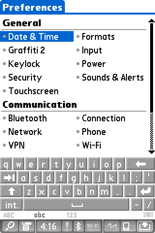
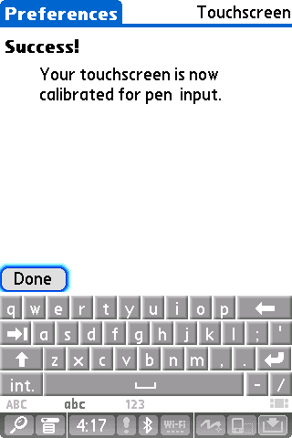
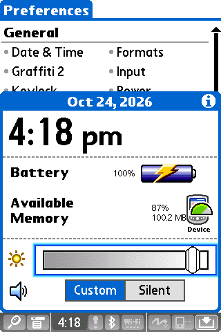

# Native input replay

`--input-replay FILE` sends pen and key events through the same SoC event queues
used by the native SDL input handler. It supports headless input checks without
calling Palm APIs to bypass the emulated hardware.

Each line contains milliseconds since the main loop started, a command, and its
arguments. Events must be in nondecreasing time order. Empty lines and `#` comments
are allowed. Coordinates are unscaled guest-screen pixels; TX coordinates range
from `(0, 0)` to `(319, 479)`, including the dynamic input area.

```text
90000 snapshot /tmp/tx-before.png
95000 pen-down 30 306
100000 pen-up
110000 snapshot /tmp/tx-after-tap.png
115000 key-down home
116000 key-up home
125000 snapshot /tmp/tx-after-home.png
```

For a running emulator, use the console command `input-replay /path/to/file`.
Times in that file then start at zero when the command loads it. This replaces
any pending replay, so a one-line `0 snapshot /tmp/current.png` script can capture
the current screen without restarting the guest. Invalid files leave the previous
replay intact.

Run a fixed startup replay after building:

```sh
SDL_VIDEODRIVER=dummy SDL_AUDIODRIVER=dummy ./out/frond \
  --experimental-tx /path/to/Palm-TX-5.4-nor.bin \
  --nand /path/to/Palm-TX-5.4-nand.bin --no-sound --run-for 130 \
  --input-replay /path/to/input.replay
```

Commands: `pen-down X Y`, `pen-move X Y`, `pen-up`, `key-down KEY`, `key-up KEY`,
and `snapshot PATH`. For an attached infrared keyboard, `keyboard-down NAME` and
`keyboard-up NAME` take SDL scancode names such as `Z` or `"Left Shift"`. Snapshot filenames may be quoted. Output directories must
already exist. Key names are `home`, `calendar`, `contacts`, `web`, `up`, `down`,
`left`, `right`, `center`, and `power`. Short host-time presses can be missed when guest execution is slow. Hold Home
to open the recent-apps menu.

Replay timing uses host wall time and is subject to emulation-loop jitter. It is
not deterministic guest-instruction replay. Ensure the startup screenshot shows
setup before interpreting a later click; a slow host may need longer delays.
`--run-for` must extend past the final event.

## TX input model

The codec's GPIO2/IRQ connects to **PXA GPIO27**. The inherited GPIO39 connection
reached another guest interrupt handler. The TX driver uses the codec's sticky
virtual GPIO13 pen detector; E2 keeps its separate GPIO3/PENDOWN connection.
The pin assignment is corroborated by the upstream Linux
[Palm TX touchscreen driver](https://code.googlesource.com/linux/torvalds/linux/+/56bf6fc266ca14d2b9276c8a62e4ff6783bfe68b/drivers/input/touchscreen/mainstone-wm97xx.c).

Slot-mode ADC conversions update both the AC-link stream and readable result
register. A coordinate poll stays busy until its final conversion. The codec
reports accepted register writes as completed, and exposes read-only power-ready
status, allowing the guest to leave its initialization polling loops.

The controller honors interrupt masks, updates FIFO/global interrupt status, and
completes mapped FIFO reads/writes even on underrun or overflow. In the previous
model, the TX's 16-read FIFO flush raised a CPU data abort at guest address
`0x200986b8`. Empty receive reads now expose stale FIFO storage without advancing
the pointer and set FIFOE; transmit underrun repeats the last sample. Halfword
reads write only the requested two bytes.

The virtual panel maps all 320×480 pixels into ADC range 320–3800, with both axes
running in the direction expected by the driver. Its synthetic mouse pressure
is 100; the supplied TX driver rejects readings of 320 and above. The old value
of 1000 was rejected. Pressure is a fixed mouse stimulus, not measured force.

Register behavior follows the
[WM9712L datasheet](https://d3uzseaevmutz1.cloudfront.net/pubs/proDatasheet/WM9712L_v4.6.pdf),
tables 26, 28, 29, 38, and 41, and the
[Intel PXA27x developer manual](https://docs.toradex.com/100211-colibri-arm-som-pxa270-technical-reference-manual.pdf),
sections 13.6.5 and 13.7.15–16. The stale receive data is a deterministic model of
the manual's invalid-data result on empty reads; software must check FIFOE.
Other virtual codec GPIO interrupt sources and analogue settling delays are not
implemented by this change.

## Calibration and working NAND images

An imported device dump contains that physical panel's calibration. If clicks
are offset, open Preferences → Touchscreen and tap the three displayed targets.
Arrow keys and Return provide five-way navigation; use short presses. Holding
Return opens Alerts, and holding F1/Home opens recent apps.

The console can export the current raw NAND, including spare bytes:

```text
save-nand out/tx-working-nand.bin
```

Use a new output filename, then start subsequent runs with that copy passed to
`--nand`. This exports flash contents, not CPU/RAM/peripheral session state. Use a
[session](session-testing.md) for the complete running state. Guest preferences
must have been committed to flash before NAND export; cold-start the exported
image to confirm that it retained them.

## Regression checks

`make test` exercises the actual codec model using its AC97 register callbacks:
pen IRQ assertion, sticky release, acknowledgement, motion after acknowledgement,
repeat presses, masking, inversion, digitiser wake-up, tagged X/Y/pressure
samples, slot/register readback, poll completion, power-ready status, accepted
write completion, powered-off conversion suppression, and the E2 direct output. A separate test
exercises the controller through its memory-mapped register interface: completion
masking and acknowledgement, receive-FIFO threshold assertion, draining below the
threshold, global FIFO status summaries, transmit service, and masking a pending
service interrupt, FIFO underrun/overflow bus completion, stale receive data,
and halfword access width. These tests require no firmware.

Replay parser checks require supplied firmware paths but reject malformed scripts
before guest execution:

```sh
python3 tools/test-input-replay.py ./out/frond \
  /path/to/Palm-TX-5.4-nor.bin /path/to/Palm-TX-5.4-nand.bin
```

## Visual checks

Inspect snapshots after each action: completing setup should open Preferences,
calibration should accept the displayed target positions, and a pen-down /
pen-move / pen-up sequence should move a slider. Repeat with another app to
check that controls respond through normal guest input handling.






